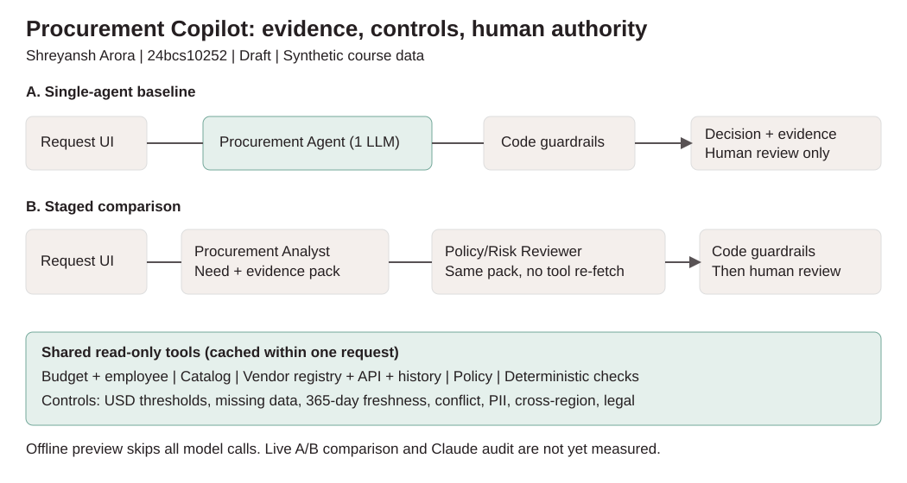

# AI Procurement Request Copilot
**Shreyansh Arora | Roll number: 24bcs10252 | FDE Assessment 3**

Draft for review, not yet a complete graded submission. Built on the supplied Scaler starter pack, whose data, companies, people and prices are synthetic. No purchase, approval, budget change or external handoff is executed.

## Status and run
- Product UI, five read-only evidence/check tools, deterministic controls and A/B inference adapter implemented.
- Offline regression verified. **Live AI comparison is pending an authorized model key.** Claude source review found issues that were fixed; live readiness is still unverified.
- PDF and code remain drafts; publication and form submission require the student's review/go.

Python 3.10+ (3.11/3.12 recommended), internet for installation; run from the repository root:
```bash
./start.sh
```
Open `http://127.0.0.1:8501`. The launcher also starts the vendor-risk mock API on port 8001. Ctrl+C stops both. The startup creates `.venv` and installs packages. Windows: `python -m venv .venv`, `.venv\Scripts\python -m pip install -r requirements.txt`, then `.venv\Scripts\python run_local.py`.

Offline is the default. To enable AI, copy `.env.example` to `.env`, set `COPILOT_MODE=live`, `GEMINI_API_KEY` to your own credential, and `MODEL_NAME` to an available Gemini model. Never commit `.env`. `gemini-2.5-flash` is a configurable default, not verified account availability. Offline is a **deterministic preview**, not a replay of model outputs and not a simulated LLM benchmark. Missing keys/model failures in live mode trigger manual review, not silent offline fallback.

## Product workflow
Request -> understand business need -> budget/existing-tool/vendor/policy evidence -> code checks -> advisory recommendation -> human review. Select or edit a request, choose A/B, gather evidence, inspect all sources and download a review packet. Changing any field hides a stale decision until rerun. There is no approve button or purchasing tool.

Required output conforms to `src/contracts.py`: recommendation, evidence, required approvals, missing information, risk flags, next step, human-review requirement and actual call telemetry. `handle_request(request_id, architecture)` preserves the starter evaluation adapter. `analyze_request(dict, architecture)` accepts edited requests without hardcoding request IDs.

## Architecture and tools


A: UI -> Procurement Agent -> deterministic guardrails -> decision/human.
B: UI -> Procurement Analyst -> Policy/Risk Reviewer -> deterministic guardrails -> decision/human. Structured evidence pack and tool results pass between roles; the reviewer does not re-fetch. A attempts one model call and B two in live mode. Offline skips both.

| Tool | Source | Purpose |
|---|---|---|
| Budget lookup | employees + department budgets | Resolve identity and available budget |
| Catalog lookup | approved software | Exact/vendor/category overlap, never infer spare seats |
| Vendor-risk lookup | registry + mock API + purchase history | Surface disagreements, failure and provenance |
| Policy lookup | policy markdown | Authoritative policy version and snapshot date |
| Deterministic policy check | typed inputs + evidence | Amount thresholds, freshness, missing fields, security/privacy/legal |

Tools cache results within each request. API timeout is two seconds; no unbounded retries. Model timeout is 25 seconds, SDK retries disabled. Request text, vendor notes and tool content are untrusted. Code approval sets and risk flags cannot be removed by the model. Typed advisory routes, length limits and valid evidence IDs are checked before model output is accepted. Injection detection is only a heuristic signal, not the safety boundary. Malformed/uncited model output escalates. No write tools or secrets are supplied to the model.

## Assumptions and policy
USD amounts are already annualized (not guessed from monthly prices). Policy date is 2026-09-30; current reviews have non-future ages of at most 365 days. Thresholds are <=1,000 Manager; <=10,000 Department Head + Procurement; <=25,000 add Finance; above 25,000 add CFO. Security applies to sensitive use cases and missing/stale/conflicting assessments. PII or cross-region processing adds Privacy; nonstandard terms, new vendors >=10,000 or material cross-region issues add Legal. Positive budget checks never mean approval. Unknown cost does not receive a made-up financial approval threshold.

Catalog licensed seats are not free capacity. Overlap is a review trigger, not rejection. The model interprets a credible gap in live mode, but cannot dismiss sensitive controls. A prior purchase does not authorize a new use case. Conservative rule previews do not make semantic fit claims. Failure to read policy or core datasets stops analysis visibly; missing API/model evidence routes to human review.

## Evaluation and comparison
With `run_local.py` running in one terminal:
```bash
.venv/bin/python verify_setup.py
.venv/bin/python -m pytest -q
.venv/bin/python evals/run_public_evals.py --architecture single
.venv/bin/python evals/run_public_evals.py --architecture staged
.venv/bin/python evals/run_comparison.py
```
Both architectures use the same six public cases plus four disclosed extensions, three repeats each. Tests cover threshold boundaries, invalid costs, ambiguity/injection, PII, expired/conflicting vendor records, overlap, API/model failure and tool reuse. Comparison CSV stores per-case correctness-minimum, grounding source checks, control preservation, human escalation, latency and actual LLM/tool counts. Raw decisions are retained alongside summaries.

Current offline: 6/6 public checks each; 30/30 minimum checks per architecture; five tools/run; **zero LLM calls**. See `evals/offline/summary.json` and `comparison.csv` for exact local median/p95. Timing is environment-specific and does not measure inference. Source-reference/control checks are not independent semantic grading. The course's public harness is a minimum check, not a guarantee of marks. Live mode writes separate `evals/live/` results; failed model runs count as failures. Live qualitative grounding/recommendation review is still required.

## Ship decision and limitations
Provisionally choose A, subject to live validation, for fewer model calls and less orchestration. Offline equality cannot establish live equivalence. B needs demonstrated safety/semantic benefit to justify extra inference. Full memo under 500 words: [architecture_decision.md](docs/architecture_decision.md).

Not production ready: synthetic snapshot, no authorization/RBAC, no persistence/real procurement writes, no seat-use data, lexical category matching, heuristic injection signal, model availability unverified. Unknown/custom data classes and novel integrations need broader normalization tests. Live use requires authorized provider credentials, an inspected AI comparison.

## Submission package
- Code, architecture diagram, assumptions, reproducible evaluation and memo are here.
- `docs/24bcs10252_ShreyanshArora.pdf`: two-page report draft with problem framing and architecture.
- [Demo guide](docs/demo_script.md): student records the Loom and supplies the link.
- Source: supplied course brief and starter pack, [Drive starter pack](https://drive.google.com/file/d/1rFJsf-VQK5fyQ9qzDjsw2tR0bACQujkA/view).
- Do not submit until live gaps are closed, PDF/demo reviewed and public GitHub publication explicitly approved. Form: https://forms.gle/ab9DrohuNQWukXCD9.

## Code-orchestrated retrieval
Tools run in a fixed order so a model cannot skip mandatory evidence. Inference emits schema-forced advisory tool output, not model-selected retrieval calls. Model advice, code route and final route are preserved separately. Offline A/B runs use the identical code path; timing differences are noise, not an architecture comparison.
